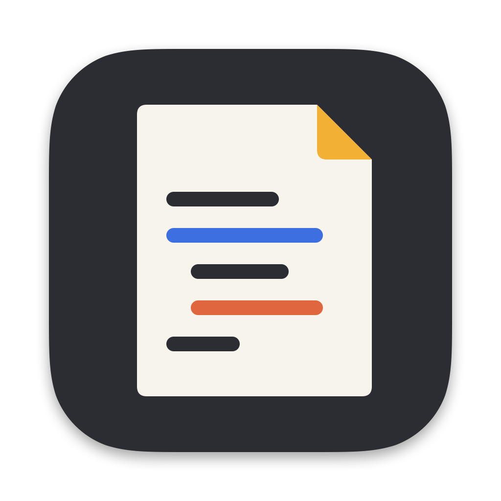
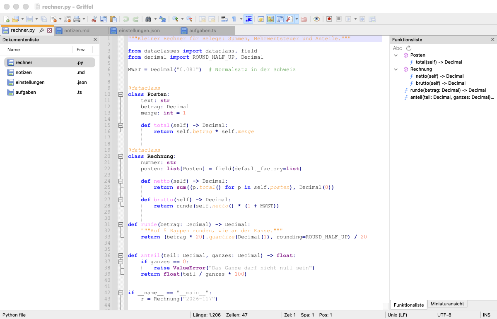
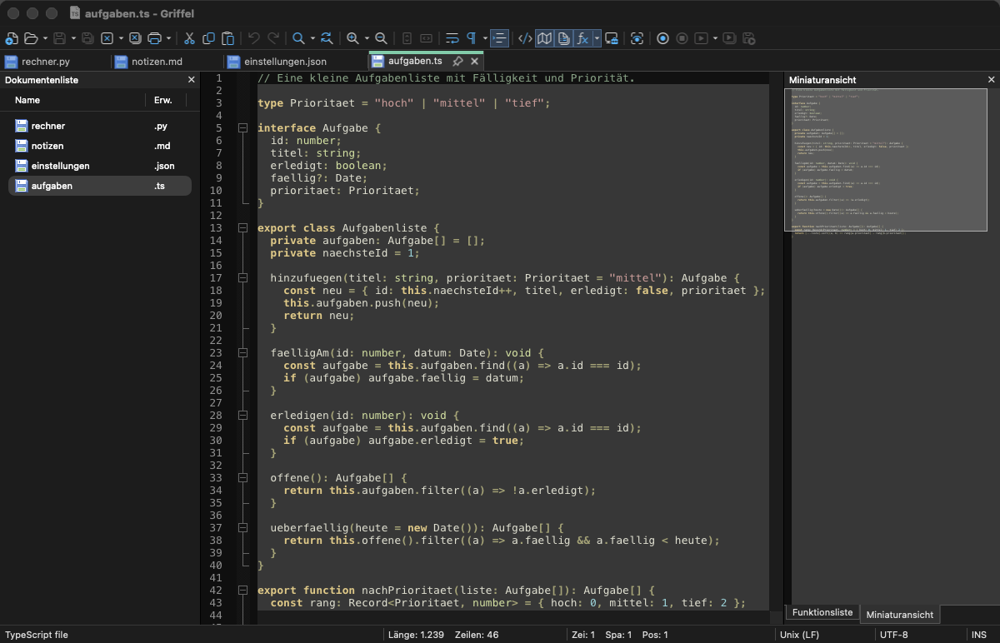
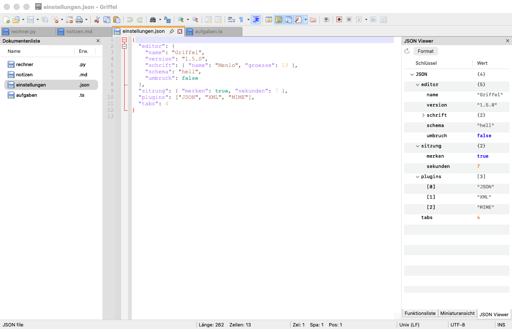
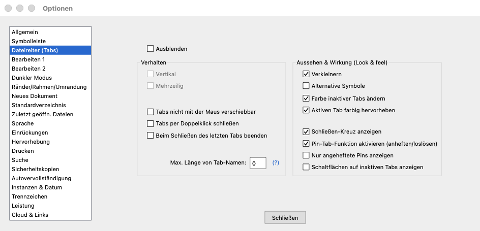

# Griffel

Ein Texteditor für den Mac nach dem Vorbild von Notepad++. Bis Version 1.4 hiess er «Kladde».

Der Editor-Kern ist derselbe wie in Notepad++: Scintilla (Bearbeiten, Darstellung) und Lexilla
(Syntaxfarben), gebaut aus dem Quellcode von Notepad++. Sprachen, Farbschemata, Funktionslisten und
Autovervollständigung kommen ebenfalls von dort. Die Oberfläche ist in Swift mit AppKit nachgebaut
und sieht aus wie die von Notepad++: ein Fenster mit der Werkzeugleiste und ihren Original-Symbolen,
die Tableiste mit Heften und Schliessen, die Menüs mit allen Befehlen und den Texten der deutschen
Übersetzung (nicht umgesetzte stehen ausgegraut), der Suchen-Dialog mit seinen vier Reitern, die
Dialoge Gehe zu, Ausführen, Block-Editor, Makro mehrfach, Hashwert und Speichern im Windows-Stil von
Notepad++ (Aufbau aus dessen .rc-Dateien), die Seitenleisten mit Reitern unten und die Statusleiste.
«Optionen» hat alle 23 Seiten von Notepad++; was Griffel einstellen kann, wirkt sofort (Tableiste,
Symbolleiste, aktuelle Zeile, Cursor, Zeilenumbruch, Faltungsstil, senkrechte Kanten, Änderungshistorie,
neue Dokumente, Einrückung, Hervorhebung, Autovervollständigung, Sitzung …), der Rest steht ausgegraut. Nur Fensterrahmen und Menüleiste oben sind vom Mac. Für Apple
Silicon und Intel, ab macOS 13.



## Was Griffel kann

**Dateien.** Tabs, «Zuletzt benutzt», Zeichensätze UTF-8, UTF-8 mit BOM, UTF-16 LE/BE und
Windows-1252, Zeilenenden CRLF, LF und CR – erkannt, angezeigt und umstellbar wie im Menü
«Kodierung» von Notepad++, samt «Neu öffnen als». Die Sitzung: Beim Beenden fragt Griffel nicht nach;
alle Tabs, auch nie gesicherte, und ungesicherte Änderungen sind beim nächsten Start wieder da, mit
Einfügemarke, Lesezeichen und vorderem Tab. Alle 10 Sekunden eine Zwischensicherung. Tabs lassen sich
ziehen, anheften und mit der mittleren Maustaste schliessen; Sitzungen auch als Datei sichern und laden.
Datei überwachen (wie `tail -f`), umbenennen, in den Papierkorb, drucken.

**Sprachen und Darstellung.** Die 94 Sprachen und 23 Farbschemata von Notepad++. Die Sprache folgt
aus Dateiname, Endung oder erster Zeile (`#!`, `<?xml`, `<!DOCTYPE html>`), das Menü «Sprache» ist
wie dort nach Anfangsbuchstaben geordnet. Farbschema «Automatisch» folgt hell und dunkel von macOS.
Faltung, leuchtende Klammerpaare, Smart Highlighting (ein ausgewähltes Wort leuchtet überall),
sichtbare Leerzeichen, Tabs und Zeilenenden, Einrückungshilfen, Zeilenumbruch, geteilte Ansicht.
Benutzerdefinierte Sprachen (UDL) aus Notepad++ lassen sich importieren.



**Suchen.** Der Dialog «Suchen und ersetzen» von Notepad++ mit den Reitern Suchen, Ersetzen, In
Dateien suchen und Hervorheben, den drei Modi (Normal, Erweitert mit `\n`, `\t`, `\x41` …,
Regulärer Ausdruck), Gross/klein, ganzes Wort, Verlauf, Transparenz. Ersetzen mit `$1`, `\1`,
`\U…\E`, Alle markieren, nur in der Auswahl, in allen offenen Dateien. «In Dateien suchen» mit Filter
wie `*.swift *.md !*.min.js !\build`, im Hintergrund; Ersetzen in Dateien erst nach Rückfrage,
Zeichensatz, Zeilenenden und Rechte der Dateien bleiben. Die Treffer stehen unten im Fenster im
Suchergebnis, eingefärbt und gefaltet wie dort. Dazu die inkrementelle Suche unter dem Text und fünf
Hervorhebungsstile.


**Bearbeiten.** Zeilen duplizieren, löschen, verschieben, verbinden, sortieren (14 Arten), doppelte
und leere entfernen, Leerzeichen kürzen, Tabs ↔ Leerzeichen; Gross/klein in acht Arten; Kommentar
und Blockkommentar umschalten nach den Zeichen der Sprache; Spalteneditor für Text und Zahlenfolgen;
mehrere Einfügemarken und Rechteckauswahl (⌥ + Ziehen); Lesezeichen; Makros aufnehmen, abspielen,
mehrfach oder bis zum Ende, unter Namen sichern.

**Plugins, eingebaut.** Was man in Notepad++ nachinstalliert, steht hier schon im Menü «Plugins», unter
den Namen der Plugins: **JSON Viewer** (Format JSON, Compress JSON, Validate JSON und die Baumansicht
rechts; Reihenfolge, Zahlen und Texte bleiben genau erhalten), **XML Tools** (Pretty print, Linarize
XML, Check XML syntax now), **MIME Tools** (Base64 und URL kodieren und dekodieren) und **Converter**
(ASCII ↔ HEX). Alles wirkt auf die Auswahl oder ohne Auswahl auf das ganze Dokument, ein Fehler springt
an seine Stelle, und ⌘Z nimmt es in einem Schritt zurück.



**Seitenleisten und Hilfen.** Funktionsliste (für 44 Sprachen), Dokumentenliste, Miniaturansicht und
Ordner als Arbeitsbereich. Vorschläge beim Tippen aus dem Text und den Wortlisten von Notepad++
(34 Sprachen) samt Aufrufhilfe, Gehe zu Zeile, zur passenden Klammer, synchrones Scrollen der
geteilten Ansicht. Statusleiste wie in Notepad++ («Länge: … Zeilen: …», «Zei: … Spa: … Pos: …»,
Zeilenende, Zeichensatz, INS/OVR; ein Klick öffnet das passende Menü). Hashwerte (MD5, SHA-1,
SHA-256, SHA-512), «Ausführen …» mit den Variablen von Notepad++, Datei im Browser öffnen.
Befehl `griffel` fürs Terminal (installieren im Menü «Griffel»).

**Optionen.** Der Dialog hat alle 23 Seiten von Notepad++ (⌘,). Was Griffel einstellen kann, wirkt
sofort; der Rest steht ausgegraut.



### Tastenkürzel

Die von Notepad++, mit ⌘ statt Ctrl und ⌥ statt Alt. Wo macOS ⌘ selbst braucht (⌘H, ⌘M, ⌘Q,
⌘Tab, ⌘Leertaste), steht ⌃. Rückgängig/Wiederholen sind ⌘Z und ⇧⌘Z, Beenden ⌘Q.

| | |
| --- | --- |
| ⌘F / ⌃H / ⇧⌘F | Suchen / Ersetzen / In Dateien suchen |
| F3 / ⇧F3 | Weitersuchen / rückwärts |
| ⌥⌘I | Inkrementelle Suche |
| ⌘G | Gehe zu |
| ⌘B | Zur passenden Klammer |
| ⌘D / ⌘L / ⇧⌘L | Zeile duplizieren / ausschneiden / löschen (Scintilla) |
| ⇧⌘↑ / ⇧⌘↓ | Zeilen verschieben |
| ⌘J / ⌘I | Zeilen verbinden / teilen |
| ⌃Q / ⌘K / ⇧⌘K | Kommentar umschalten / setzen / entfernen |
| ⇧⌘Q | Blockkommentar |
| ⇧⌘U / ⌘U | GROSS / klein |
| ⌥C | Spalteneditor |
| ⌘F2 / F2 / ⇧F2 | Lesezeichen setzen / nächstes / vorheriges |
| ⇧⌘R / ⇧⌘P | Makro aufnehmen / abspielen |
| ⌥0 / ⇧⌥0 | Alles ein- / ausklappen |
| F5 | Ausführen |
| F7 / F4 | Suchergebnis / nächster Treffer |

## Installieren

Unter [Releases](https://github.com/simon-baumhauer/griffel/releases) das DMG laden, öffnen und
**Griffel** in **Programme** ziehen.

Griffel ist nicht bei Apple beglaubigt. Beim ersten Öffnen meldet macOS darum, die App könne nicht
geprüft werden. Dann **Systemeinstellungen → Datenschutz & Sicherheit** öffnen und bei «Griffel» auf
**Dennoch öffnen** klicken, oder im Terminal:

```bash
xattr -dr com.apple.quarantine /Applications/Griffel.app
```

Wer Kladde schon hat: Griffel ist dieselbe App unter neuem Namen und übernimmt Einstellungen, Sitzung
und benutzerdefinierte Sprachen. Kladde.app danach in den Papierkorb legen; beide tragen dieselbe
Kennung, und macOS öffnet sonst manchmal die alte. Ein früher installierter Befehl `kladde` öffnet
weiterhin Griffel.

## Bauen

Voraussetzung: Xcode (ab 16). Der erste Lauf holt den Quellcode von Notepad++ auf einem festen Stand
nach `extern/notepad-plus-plus` und baut Scintilla und Lexilla (einige Minuten).

```bash
./scripts/app-bauen.sh --start
```

Das Ergebnis ist `build/Griffel.app`. Mit `--universell` entsteht die App für Apple Silicon und Intel.
Das DMG baut `./scripts/dmg-bauen.sh`; mit `GRIFFEL_IDENTITAET` (eine «Developer ID») und
`GRIFFEL_NOTAR_PROFIL` (ein Profil von `xcrun notarytool store-credentials`) signiert und beglaubigt es
die App. Ein Tag `v…` baut das DMG auf GitHub und legt es an ein Release. Das Icon zeichnet
`swift scripts/icon.swift Ressourcen/Griffel.icns`.

## Prüfen

```bash
swift test
```

prüft Zeichensätze, Suchen und Ersetzen, die Suche im Ordner, die Zeilen- und Textwerkzeuge,
Funktionsliste, Autovervollständigung, benutzerdefinierte Sprachen und die eingebauten Plugins (57 Tests; einige lesen dazu die
Dateien von Notepad++). Auf GitHub laufen sie bei jedem Push.

Die App kann sich selbst prüfen und schreibt einen Bericht samt Bildern ihrer Fenster
(`Sources/Kladde/Probe.swift`). Im Hintergrund starten, damit sie keine Tasten abfängt:

```bash
open -g -n -W -a build/Griffel.app datei.txt --args -KladdeProbe /tmp/probe -KladdeProbeAktion nichts -KladdeSitzung /tmp/sitzung -KladdeUDL /tmp/udl
```

Die Bilder in diesem README erneuert `./scripts/bilder.sh`: Eine Kopie der App mit eigener Kennung
öffnet die Beispiele aus `docs/bilder/beispiele/` und zeichnet ihre Fenster selbst (Selbstprüfung
«bilder»).

## Aufbau

| Ort | Inhalt |
| --- | --- |
| `Sources/Kladde/` | Die App: Hauptfenster, Werkzeug-, Tab- und Statusleiste, Befehle der Menüs, Editor, Suchen-Dialog, Suchergebnis, Seitenleisten, Sitzung |
| `Sources/KladdeKern/` | Ohne Oberfläche und mit Tests: Zeichensätze, Suchen und Ersetzen, Suche im Ordner, Textwerkzeuge, Funktionsliste, Autovervollständigung, UDL |
| `Tests/KladdeKernTests/` | Tests dazu |
| `Sources/ScintillaBruecke/` | Macht ScintillaView und Lexilla für Swift sichtbar |
| `extern/mac/windows.h` | Ersatz für `<windows.h>`, damit der UDL-Lexer von Notepad++ auf dem Mac baut |
| `scripts/` | Bau von Kern, App, Sprachdaten, Icon, DMG und der Bilder fürs README |
| `Ressourcen/` | Info.plist, Icon, Befehl `griffel` |

Ordner, Module, die Kennung `io.github.simon-baumhauer.kladde` und die Startschalter `-Kladde…` tragen
noch den alten Namen; umbenannt ist, was man in der App, beim Installieren und im Terminal sieht.

Sprachen und Farbschemata entstehen beim Bauen aus `langs.model.xml`, `stylers.model.xml` und
`installer/themes/` von Notepad++ (`scripts/sprachdaten.py`). Menüs, Kürzel, Tab-Menü, das Layout des
Suchen-Dialogs und die deutschen Texte liest `scripts/oberflaeche.py` aus `Notepad_plus.rc`,
`Parameters.cpp`, `FindReplaceDlg.rc` und `german.xml`; die Symbole kommen aus `src/icons/`. Wie Notepad++ jede Sprache in Scintilla
einrichtet, steht in `Sources/Kladde/Sprachregeln.swift`.

Die Sitzung liegt unter `~/Library/Application Support/Griffel/Sitzung/`, benutzerdefinierte
Sprachen unter `~/Library/Application Support/Griffel/userDefineLangs/`; der Ordner `Kladde` von
früher zieht beim ersten Start dorthin um. Die Dateien der Dokumente fasst die Sitzung nie an; erst
«Sichern» schreibt sie.

## Unterschiede zu Notepad++

- **Regex.** Griffel sucht mit ICU (`NSRegularExpression`), Notepad++ mit Boost. Für das Übliche gleich;
  `\K`, `\<`, `\>` und benannte Gruppen im Ersetzungstext (`$+{name}`) kennt die Suche nicht.
- **Funktionslisten.** Ihre Boost-Ausdrücke übersetzt `Sources/KladdeKern/Funktionsliste.swift` für ICU
  (`\K`, `(?&NAME)`, `(?R)`, `(?(DEFINE)…)`, Kommentare im Modus `(?x)` …). Bedingungen `(?(…)…|…)` kann
  ICU nicht; für SQL, VHDL und NppExec gibt es darum keine Funktionsliste.
- **Benutzerdefinierte Sprachen** lassen sich importieren (Format ab 2.0), aber nicht in einem Dialog
  bearbeiten.
- **Plugins** von Notepad++ laufen nicht: Sie sind Windows-Programme. JSON Viewer, XML Tools, MIME
  Tools und Converter sind darum in Griffel nachgebaut (ohne ihren Code), weitere nicht.
- **Menütexte.** Wo Notepad++ Windows meint, steht der Mac: «Finder» statt «Explorer», «Terminal»
  statt «Kommandozeile», «Griffel» statt «Notepad++».
- **Schrift.** Wie im Farbschema (meist Courier New, sonst Menlo), oder fest in den Einstellungen.
- **Tastenkürzel** sind nicht im Programm umstellbar; macOS kann sie unter «Systemeinstellungen →
  Tastatur → Tastaturkurzbefehle → App-Kurzbefehle» ändern.

## Lizenz

GPL v3, wie Notepad++ (siehe [`LICENSE`](LICENSE)). Was von wem stammt, steht in
[`DRITTE.md`](DRITTE.md). Griffel übernimmt keinen Code von Notepad++, nur dessen Daten, Symbole und
den Editor-Kern; «Notepad++» ist der Name des Vorbilds, nicht dieses Programms.
