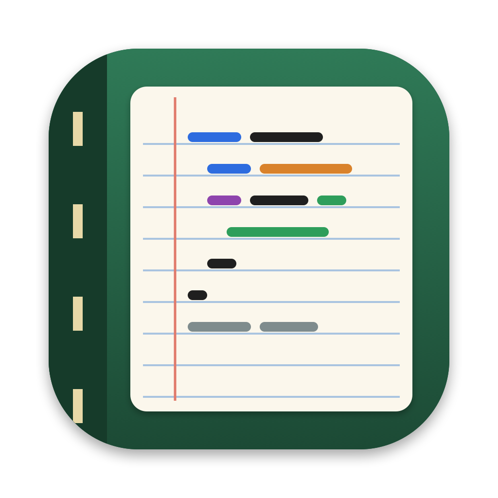

# Kladde

Ein Texteditor für den Mac nach dem Vorbild von Notepad++. «Kladde» ist der Arbeitsname.

Der Editor-Kern ist derselbe wie in Notepad++: Scintilla (Bearbeiten, Darstellung) und Lexilla
(Syntaxfarben), gebaut aus dem Quellcode von Notepad++. Die Oberfläche ist neu, in Swift mit AppKit,
weil die von Notepad++ fest an Windows hängt.

## Bauen

Voraussetzung: Xcode. Der erste Lauf holt den Quellcode von Notepad++ nach `extern/notepad-plus-plus`
und baut den Kern (rund zwei Minuten).

```bash
./scripts/app-bauen.sh --start
```

Das Ergebnis ist `build/Kladde.app`. Nur den Kern neu bauen: `./scripts/extern-bauen.sh`.

## Aufbau

| Ort | Inhalt |
| --- | --- |
| `Sources/Kladde/` | Die App: Dokument, Fenster, Menüs, Editor, Suchleiste, Ergebnisse, Sitzung |
| `Sources/KladdeKern/` | Ohne Oberfläche und mit Tests: Zeichensätze, Suchen und Ersetzen, Suche im Ordner |
| `Tests/KladdeKernTests/` | Tests dazu (`swift test`) |
| `Sources/ScintillaBruecke/` | Macht ScintillaView und Lexilla für Swift sichtbar |
| `extern/mac/windows.h` | Ersatz für `<windows.h>`, damit der UDL-Lexer von Notepad++ auf dem Mac baut |
| `scripts/` | Bau des Kerns und des App-Bündels |
| `Ressourcen/Info.plist` | Angaben des Bündels |

## Stand

Etappe 6 von 7.

- **Etappe 1:** Fenster, Tippen, Öffnen, Sichern, Tabs, Zeilennummern.
- **Etappe 2:** Menü «Kodierung» wie in Notepad++: Zeichensatz (UTF-8, UTF-8 mit BOM, UTF-16 LE/BE,
  Windows-1252) und Zeilenende (CRLF, LF, CR) mit Haken anzeigen und umstellen, «Neu öffnen als»
  für falsch erkannte Dateien. «Ablage → Zuletzt benutzt». Sitzung: Beim Beenden fragt Kladde nicht
  nach; offene Tabs, auch nie gesicherte, und ungesicherte Änderungen sind beim nächsten Start
  wieder da, mit Einfügemarke und vorderem Tab. Alle 10 Sekunden eine Zwischensicherung.
- **Etappe 3:** Die 94 Sprachen und 23 Farbschemata von Notepad++. Sprache nach Dateiname,
  Endung oder erster Zeile (`#!`, `<?xml`, `<!DOCTYPE html>`), Menü «Sprache» nach
  Anfangsbuchstaben. «Darstellung → Farbschema» mit «Automatisch» (Standard bei hellem,
  DarkModeDefault bei dunklem macOS). Faltung mit Kästchen wie in Notepad++, «Alles ein-/ausklappen»
  (⌥⌘0, ⇧⌥⌘0). Klammerpaare leuchten. «Symbole anzeigen»: Leerzeichen und Tabs, Zeilenenden,
  Einrückungshilfen.
- **Etappe 4:** Menü «Suchen». Suchleiste im Fenster (⌘F, mit Ersetzen ⌥⌘F): sucht beim Tippen,
  zeigt «3 von 12», Weiter/Zurück (⌘G, ⇧⌘G), Ersetzen, Alle ersetzen (ein Schritt zum Widerrufen),
  Alle markieren, Nur in Auswahl, in allen offenen Dateien. Modi wie in Notepad++: Normal, Erweitert
  (`\n`, `\t`, `\x41` …), Regulärer Ausdruck; Gross/klein, Ganzes Wort, Umbruch, «.» findet
  Zeilenende. Ersetzen mit `$1`, `\1`, `${1}`, `$&`, `\U…\E`, `\L`, `\u`, `\l`. «In Dateien
  suchen …» (⇧⌘F) mit Ordner, Filter (`*.swift *.md !*.min.js !\build`), Unterordnern und
  versteckten Dateien; läuft im Hintergrund, lässt sich abbrechen, überspringt binäre Dateien,
  ersetzt erst nach Rückfrage und hält Zeichensatz, Zeilenenden und Rechte der Dateien. Treffer im
  Fenster «Suchergebnisse» (⌥⇧⌘F), Doppelklick springt hin. Smart Highlighting: ein ausgewähltes
  ganzes Wort leuchtet überall im sichtbaren Teil. Gehe zu Zeile (⌘L), zur passenden Klammer (⌘B).
- **Etappe 5:** Unter «Bearbeiten»: Zeile duplizieren (⌘D), Zeilen löschen (⇧⌘K), verschieben
  (⌥⌘↑/↓), verbinden (⌃⌘J), sortieren (14 Arten wie in Notepad++), doppelte und leere Zeilen
  entfernen, Leerzeichen kürzen, Tabs ↔ Leerzeichen, Gross/klein (acht Arten), Kommentar und
  Blockkommentar umschalten (⌘/, ⌥⌘/, nach den Zeichen der Sprache), Spalteneditor (⌥⌘C) für Text
  oder Zahlenfolgen, Überschreiben. Lesezeichen im Rand (⌘F2, F2, ⇧F2) samt «Zeilen mit
  Lesezeichen kopieren/löschen»; «Alle markieren» kann sie setzen; die Sitzung merkt sie sich.
  Menü «Makro»: aufnehmen (⇧⌘R), abspielen (⇧⌘P), mehrfach oder bis zum Ende, unter einem Namen
  sichern. Geteilte Ansicht (übereinander oder nebeneinander, derselbe Text). Statusleiste mit
  Sprache, Länge, Position, Auswahl, Zeilenende, Zeichensatz und EINF/ÜB, die drei ersten zum
  Umstellen per Klick. Einstellungen (⌘,): Schrift, Grösse, Farbschema, Tabbreite, Anzeige,
  Auto-Einzug, Klammern schliessen, Smart Highlighting, Sitzung.
- **Etappe 6:** Funktionsliste rechts im Fenster (⌥⌘L) aus den Regeln von Notepad++
  (`installer/functionList`), 44 von 47 Sprachen. Vorschläge beim Tippen aus den Wörtern des Textes
  und den API-Listen von Notepad++ (`installer/APIs`, 34 Sprachen), dazu die Aufrufhilfe mit
  Parametern. Benutzerdefinierte Sprachen (UDL ab Version 2.0) aus Notepad++: «Sprache →
  Benutzerdefiniert → Importieren …», mit dem Lexer von Notepad++. Icon. Befehl `kladde` fürs
  Terminal (in den Einstellungen).

Die Regex ist die von ICU (`NSRegularExpression`), nicht die Boost-Regex von Notepad++. Für das
Übliche gleich; benannte Gruppen im Ersetzungstext (`$+{name}`) und `\<`, `\>` kennt sie nicht.

Sprachen und Farbschemata entstehen beim Bauen aus `langs.model.xml`, `stylers.model.xml` und
`installer/themes/` von Notepad++ (`scripts/sprachdaten.py`). Wie Notepad++ jede Sprache in
Scintilla einrichtet, steht in `Sources/Kladde/Sprachregeln.swift`. Die Schrift kommt aus den
Einstellungen (Vorgabe Menlo 13); die Schriften der Farbschemata (meist Courier New) gelten nicht.

Die Funktionslisten von Notepad++ sind für die Regex von Boost geschrieben.
`Sources/KladdeKern/Funktionsliste.swift` übersetzt sie für ICU: `\K`, `(?&NAME)`, `(?R)`,
`(?(DEFINE)…)`, `\k'NAME'`, Gruppennamen mit `_`, lose `{`, `}`, `]` und die Kommentare im Modus
`(?x)`. Bedingungen `(?(…)…|…)` kann ICU nicht; für SQL, VHDL und NppExec gibt es darum keine
Funktionsliste. Benutzerdefinierte Sprachen lassen sich importieren, aber (noch) nicht in einem
Dialog bearbeiten; die XML-Dateien liegen unter `~/Library/Application Support/Kladde/userDefineLangs/`.

Die Sitzung liegt unter `~/Library/Application Support/Kladde/Sitzung/`. Die Dateien der Dokumente
fasst sie nie an; erst «Sichern» schreibt sie.

## Prüfen

```bash
swift test
```

prüft Zeichensätze, Suchen, Ersetzen, die Suche im Ordner, die Textwerkzeuge, Funktionsliste,
Autovervollständigung und benutzerdefinierte Sprachen (49 Tests; manche lesen die Dateien von Notepad++).

Die App kann sich selbst prüfen und schreibt einen Bericht samt Bildern der Fenster
(`Sources/Kladde/Probe.swift`). Im Hintergrund starten, damit sie keine Tasten abfängt:

```bash
open -g -n -W -a build/Kladde.app datei.txt --args -KladdeProbe /tmp/probe -KladdeProbeAktion nichts -KladdeSitzung /tmp/sitzung
```

## Lizenz

GPL v3, wie Notepad++ (siehe `LICENSE`). Scintilla und Lexilla stehen unter ihrer eigenen, freien Lizenz.
