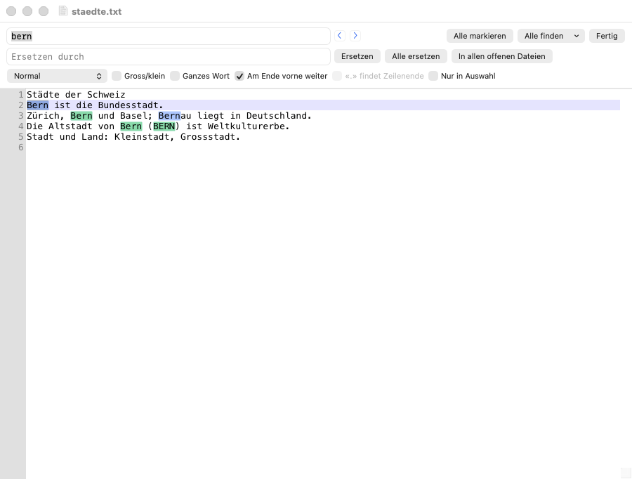

# Kladde

Ein Texteditor für den Mac nach dem Vorbild von Notepad++.

Der Editor-Kern ist derselbe wie in Notepad++: Scintilla (Bearbeiten, Darstellung) und Lexilla
(Syntaxfarben), gebaut aus dem Quellcode von Notepad++. Sprachen, Farbschemata, Funktionslisten und
Autovervollständigung kommen ebenfalls von dort. Die Oberfläche ist neu, in Swift mit AppKit, weil
die von Notepad++ fest an Windows hängt. Für Apple Silicon und Intel, ab macOS 13.


## Was Kladde kann

**Dateien.** Tabs, «Zuletzt benutzt», Zeichensätze UTF-8, UTF-8 mit BOM, UTF-16 LE/BE und
Windows-1252, Zeilenenden CRLF, LF und CR – erkannt, angezeigt und umstellbar wie im Menü
«Kodierung» von Notepad++, samt «Neu öffnen als». Die Sitzung: Beim Beenden fragt Kladde nicht nach;
alle Tabs, auch nie gesicherte, und ungesicherte Änderungen sind beim nächsten Start wieder da, mit
Einfügemarke, Lesezeichen und vorderem Tab. Alle 10 Sekunden eine Zwischensicherung.

**Sprachen und Darstellung.** Die 94 Sprachen und 23 Farbschemata von Notepad++. Die Sprache folgt
aus Dateiname, Endung oder erster Zeile (`#!`, `<?xml`, `<!DOCTYPE html>`), das Menü «Sprache» ist
wie dort nach Anfangsbuchstaben geordnet. Farbschema «Automatisch» folgt hell und dunkel von macOS.
Faltung, leuchtende Klammerpaare, Smart Highlighting (ein ausgewähltes Wort leuchtet überall),
sichtbare Leerzeichen, Tabs und Zeilenenden, Einrückungshilfen, Zeilenumbruch, geteilte Ansicht.
Benutzerdefinierte Sprachen (UDL) aus Notepad++ lassen sich importieren.

**Suchen.** Suchleiste im Fenster mit den drei Modi von Notepad++ (Normal, Erweitert mit `\n`, `\t`,
`\x41` …, Regulärer Ausdruck), Gross/klein, ganzes Wort, «3 von 12», Ersetzen mit `$1`, `\1`,
`\U…\E`, Alle markieren, nur in der Auswahl, in allen offenen Dateien. «In Dateien suchen» mit Filter
wie `*.swift *.md !*.min.js !\build`, im Hintergrund, mit Ergebnisliste; Ersetzen in Dateien erst
nach Rückfrage, Zeichensatz, Zeilenenden und Rechte der Dateien bleiben.



**Bearbeiten.** Zeilen duplizieren, löschen, verschieben, verbinden, sortieren (14 Arten), doppelte
und leere entfernen, Leerzeichen kürzen, Tabs ↔ Leerzeichen; Gross/klein in acht Arten; Kommentar
und Blockkommentar umschalten nach den Zeichen der Sprache; Spalteneditor für Text und Zahlenfolgen;
mehrere Einfügemarken und Rechteckauswahl (⌥ + Ziehen); Lesezeichen; Makros aufnehmen, abspielen,
mehrfach oder bis zum Ende, unter Namen sichern.

**Hilfen.** Funktionsliste rechts im Fenster (für 44 Sprachen), Vorschläge beim Tippen aus dem Text
und den Wortlisten von Notepad++ (34 Sprachen) samt Aufrufhilfe, Gehe zu Zeile, zur passenden
Klammer. Statusleiste mit Sprache, Länge, Position, Auswahl, Zeilenende, Zeichensatz und EINF/ÜB.
Befehl `kladde` fürs Terminal (in den Einstellungen).

### Tastenkürzel

| | |
| --- | --- |
| ⌘F / ⌥⌘F | Suchen / Ersetzen |
| ⌘G / ⇧⌘G | Weiter / zurück suchen |
| ⌘E | Auswahl zum Suchen verwenden |
| ⇧⌘F | In Dateien suchen |
| ⌘L | Gehe zu Zeile |
| ⌘B / ⇧⌘B | Zur passenden Klammer / bis dahin auswählen |
| ⌘D | Zeile duplizieren |
| ⇧⌘K | Zeilen löschen |
| ⌥⌘↑ / ⌥⌘↓ | Zeilen verschieben |
| ⌃⌘J | Zeilen verbinden |
| ⌘/ / ⌥⌘/ | Kommentar / Blockkommentar umschalten |
| ⇧⌘U / ⌥⌘U | GROSS / klein |
| ⌥⌘C | Spalteneditor |
| ⌘F2 / F2 / ⇧F2 | Lesezeichen setzen / nächstes / vorheriges |
| ⇧⌘R / ⇧⌘P | Makro aufnehmen / abspielen |
| ⌥⌘0 / ⇧⌥⌘0 | Alles ein- / ausklappen |
| ⌥⌘L | Funktionsliste |
| ⌥⌘Z | Zeilenumbruch |

## Installieren

Unter [Releases](https://github.com/simon-baumhauer/kladde/releases) das DMG laden, öffnen und
**Kladde** in **Programme** ziehen.

Kladde ist nicht bei Apple beglaubigt. Beim ersten Öffnen meldet macOS darum, die App könne nicht
geprüft werden. Dann **Systemeinstellungen → Datenschutz & Sicherheit** öffnen und bei «Kladde» auf
**Dennoch öffnen** klicken, oder im Terminal:

```bash
xattr -dr com.apple.quarantine /Applications/Kladde.app
```

## Bauen

Voraussetzung: Xcode (ab 16). Der erste Lauf holt den Quellcode von Notepad++ auf einem festen Stand
nach `extern/notepad-plus-plus` und baut Scintilla und Lexilla (einige Minuten).

```bash
./scripts/app-bauen.sh --start
```

Das Ergebnis ist `build/Kladde.app`. Mit `--universell` entsteht die App für Apple Silicon und Intel.
Das DMG baut `./scripts/dmg-bauen.sh`; mit `KLADDE_IDENTITAET` (eine «Developer ID») und
`KLADDE_NOTAR_PROFIL` (ein Profil von `xcrun notarytool store-credentials`) signiert und beglaubigt es
die App. Ein Tag `v…` baut das DMG auf GitHub und legt es an ein Release.

## Prüfen

```bash
swift test
```

prüft Zeichensätze, Suchen und Ersetzen, die Suche im Ordner, die Zeilen- und Textwerkzeuge,
Funktionsliste, Autovervollständigung und benutzerdefinierte Sprachen (49 Tests; einige lesen dazu die
Dateien von Notepad++). Auf GitHub laufen sie bei jedem Push.

Die App kann sich selbst prüfen und schreibt einen Bericht samt Bildern ihrer Fenster
(`Sources/Kladde/Probe.swift`). Im Hintergrund starten, damit sie keine Tasten abfängt:

```bash
open -g -n -W -a build/Kladde.app datei.txt --args -KladdeProbe /tmp/probe -KladdeProbeAktion nichts -KladdeSitzung /tmp/sitzung
```

## Aufbau

| Ort | Inhalt |
| --- | --- |
| `Sources/Kladde/` | Die App: Dokumente, Fenster, Menüs, Editor, Suchleiste, Ergebnisse, Funktionsliste, Sitzung |
| `Sources/KladdeKern/` | Ohne Oberfläche und mit Tests: Zeichensätze, Suchen und Ersetzen, Suche im Ordner, Textwerkzeuge, Funktionsliste, Autovervollständigung, UDL |
| `Tests/KladdeKernTests/` | Tests dazu |
| `Sources/ScintillaBruecke/` | Macht ScintillaView und Lexilla für Swift sichtbar |
| `extern/mac/windows.h` | Ersatz für `<windows.h>`, damit der UDL-Lexer von Notepad++ auf dem Mac baut |
| `scripts/` | Bau von Kern, App, Sprachdaten, Icon und DMG |
| `Ressourcen/` | Info.plist, Icon, Befehl `kladde` |

Sprachen und Farbschemata entstehen beim Bauen aus `langs.model.xml`, `stylers.model.xml` und
`installer/themes/` von Notepad++ (`scripts/sprachdaten.py`). Wie Notepad++ jede Sprache in Scintilla
einrichtet, steht in `Sources/Kladde/Sprachregeln.swift`.

Die Sitzung liegt unter `~/Library/Application Support/Kladde/Sitzung/`, benutzerdefinierte
Sprachen unter `~/Library/Application Support/Kladde/userDefineLangs/`. Die Dateien der Dokumente fasst
die Sitzung nie an; erst «Sichern» schreibt sie.

## Unterschiede zu Notepad++

- **Regex.** Kladde sucht mit ICU (`NSRegularExpression`), Notepad++ mit Boost. Für das Übliche gleich;
  `\K`, `\<`, `\>` und benannte Gruppen im Ersetzungstext (`$+{name}`) kennt die Suche nicht.
- **Funktionslisten.** Ihre Boost-Ausdrücke übersetzt `Sources/KladdeKern/Funktionsliste.swift` für ICU
  (`\K`, `(?&NAME)`, `(?R)`, `(?(DEFINE)…)`, Kommentare im Modus `(?x)` …). Bedingungen `(?(…)…|…)` kann
  ICU nicht; für SQL, VHDL und NppExec gibt es darum keine Funktionsliste.
- **Benutzerdefinierte Sprachen** lassen sich importieren (Format ab 2.0), aber nicht in einem Dialog
  bearbeiten.
- **Plugins** gibt es keine: Die von Notepad++ sind Windows-Programme.
- **Schrift.** Sie kommt aus den Einstellungen (Vorgabe Menlo 13); die Schriften der Farbschemata
  (meist Courier New) gelten nicht.
- **Tastenkürzel** folgen dem Mac (⌘ statt Ctrl) und sind nicht im Programm umstellbar; macOS kann
  sie unter «Systemeinstellungen → Tastatur → Tastaturkurzbefehle → App-Kurzbefehle» ändern.

## Lizenz

GPL v3, wie Notepad++ (siehe [`LICENSE`](LICENSE)). Was von wem stammt, steht in
[`DRITTE.md`](DRITTE.md). Kladde übernimmt keinen Code von Notepad++, nur dessen Daten und den
Editor-Kern; «Notepad++» ist der Name des Vorbilds, nicht dieses Programms.
